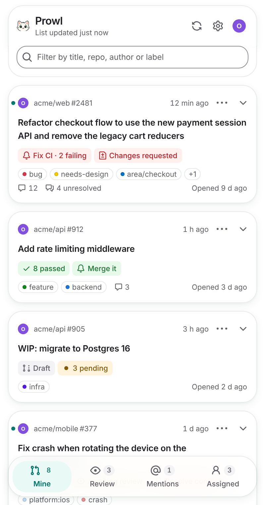
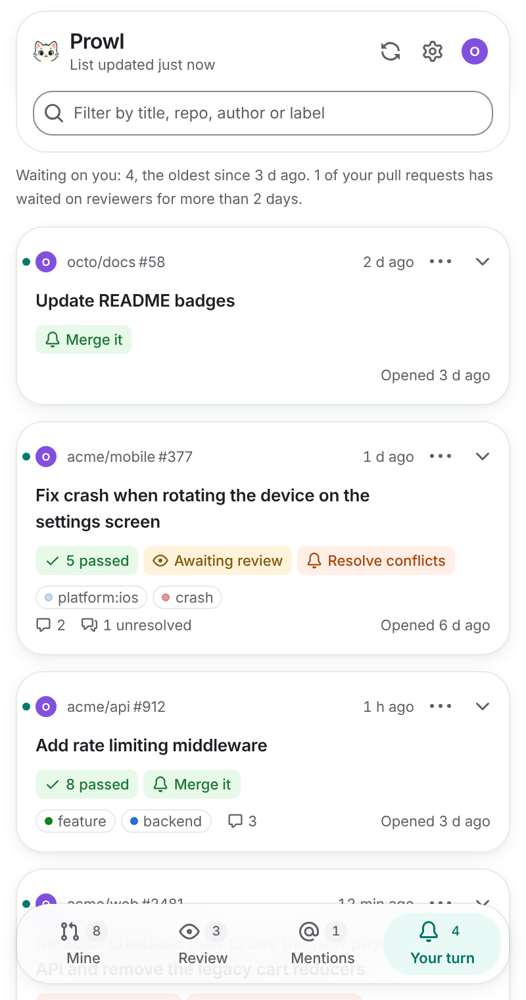
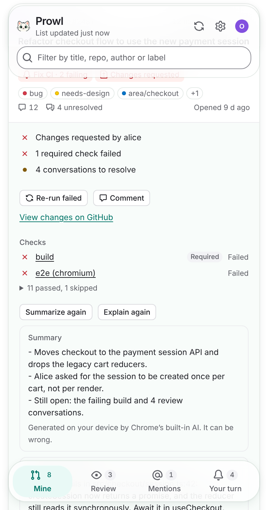
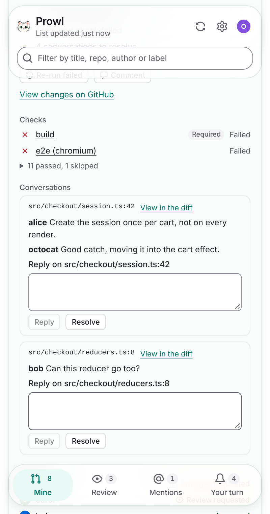
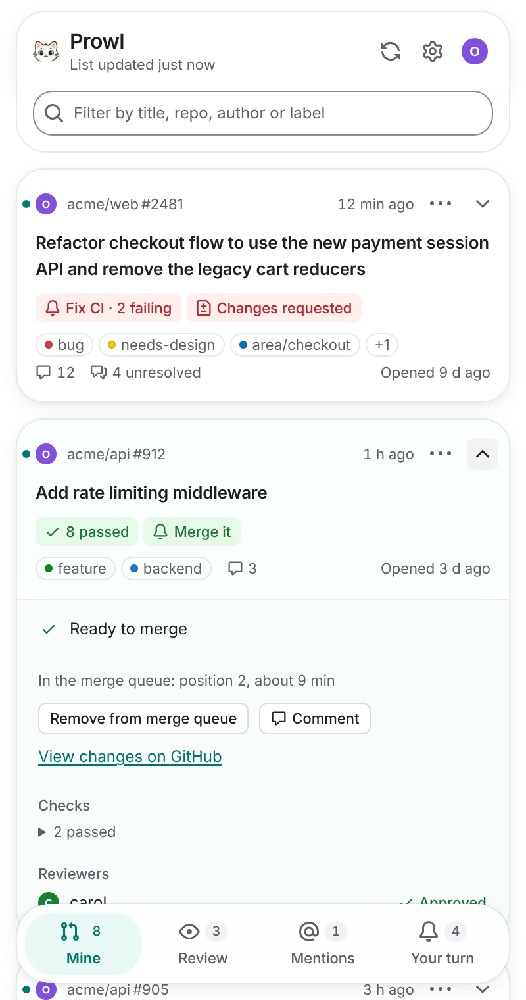
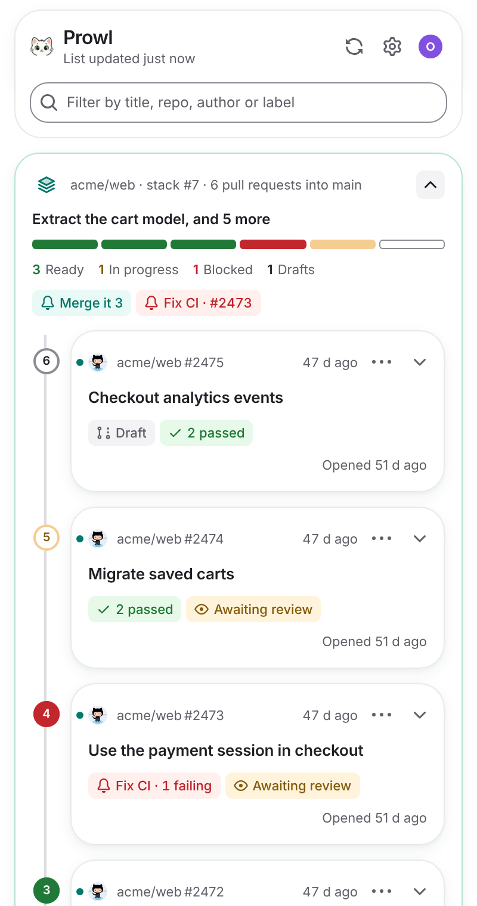

<p align="center">
  
</p>

# Prowl — GitHub Pull Request Manager

**The open source Chrome extension that keeps an eye on your pull requests.**

Free to use, inspect and improve. [MIT licensed](LICENSE), with no backend and no telemetry.
[Install from the Chrome Web Store](https://chromewebstore.google.com/detail/prowl/homnofbclfgoailffidcbgekohciglcf) · [Explore the website](https://aemard.github.io/prowl/) · [Contribute](CONTRIBUTING.md)

Prowl shows the live state of the pull requests you care about (CI, reviews, conflicts, draft,
labels, activity), notifies you when something changes, and lets you act (approve, request
changes, comment, merge, re-run failed checks, toggle draft) without leaving the tab you are on.

100% client-side: no backend, no telemetry, no third-party servers. Your token stays in your
browser and is only ever sent to GitHub.

<p align="center">
  
</p>

[Chrome Web Store](https://chromewebstore.google.com/detail/prowl/homnofbclfgoailffidcbgekohciglcf) ·
[Website](https://aemard.github.io/prowl/) ·
[Install guide](https://aemard.github.io/prowl/install/) ·
[Sign-in guide](https://aemard.github.io/prowl/auth/) ·
[Privacy](https://aemard.github.io/prowl/privacy/) ·
[Changelog](CHANGELOG.md)

[](https://www.bestpractices.dev/projects/16092)
[](https://scorecard.dev/viewer/?uri=github.com/aemard/prowl)

## Install

1. Open [Prowl in the Chrome Web Store](https://chromewebstore.google.com/detail/prowl/homnofbclfgoailffidcbgekohciglcf) and click **Add to Chrome**. It updates itself.
2. Pin Prowl from the puzzle-piece menu, then click its icon to open the side panel.
3. Sign in: **Continue with GitHub**, or paste a token (see below).

Requires Chrome 116 or later. A new version reaches the store a few days after its GitHub release,
once Google has reviewed it. To run a release sooner or without the store, download
`prowl-vX.Y.Z.zip` from the [latest release](https://github.com/aemard/prowl/releases/latest),
unzip it, then **Load unpacked** in `chrome://extensions` with **Developer mode** on (no
automatic updates; [install guide](https://aemard.github.io/prowl/install/)). Each release also ships an SBOM and a build provenance
attestation, and rebuilds byte for byte: see [verify a release](docs/releasing.md#verify-a-release).

## Sign in

| Way | What you need | CI status |
|---|---|---|
| Continue with GitHub | One click (device flow; available when the build has an OAuth client id) | Yes |
| Classic token | [Create one with the `repo` and `read:org` scopes](https://github.com/settings/tokens/new?scopes=repo,read:org&description=Prowl) | Yes |
| Fine-grained token | Pull requests, Contents, Actions (read and write), Commit statuses and Metadata (read) | Can be missing |

Fine-grained tokens cannot read check runs (GitHub only grants the Checks permission to Apps), so
CI status may be missing with them. Prowl shows when your token expires and warns a week before.
Details: [sign-in guide](docs/auth.md).

## Features

- **Language**: in **Settings → List → Language**, choose English, Japanese, Simplified
  or Traditional Chinese, French, German or Spanish, or follow Chrome's language (the default).
  The choice is saved and applies to the panel, notifications, dates and numbers, with English
  as the fallback for unavailable translations.
- **Scope**: PRs you authored by default; add review requested (from you), team reviews
  (requests to your teams, found with `read:org`), mentioned, assigned, custom GitHub
  searches, and repository include/exclude filters. Each scope sits in a bar at the bottom of
  the panel, with its count. Snooze a PR to set it aside in a "Snoozed" fold until the
  time you pick. A switch groups each tab's PRs under their repository, in collapsible groups.
- **Your turn**: a section, the toolbar badge (by default) and a notification say which pull
  requests wait on you and why (your review, a re-review after a push, CI to fix, feedback to
  answer, a merge to make), longest waiting first. On a card, the chip that states the fact
  becomes the action, with a bell ("Review", "Fix CI · 1 failing", "Merge it"). No extra GitHub
  request.
- **Deployments**: an expanded card lists where its head commit is deployed (preview, staging)
  and how that went.
- **GitHub stacks**: a stack is one item of the list, with its progress (ready, in progress,
  blocked, drafts), what waits on you, and its pull requests in merge order, each with its
  details. Merge the ready bottom of the stack, or the whole stack, in one go, or queue it.
- **Merge queues**: on a branch with a merge queue, add a PR to the queue (or take it out) and
  see its position.
- **Review conversations**: an expanded card lists the open review threads with their last
  comments; reply or resolve them without opening GitHub.
- **Fast updates**: between polls, a free conditional check of your GitHub notifications (about
  once a minute) refreshes the list within a minute or so of a review, comment or other activity
  GitHub notifies you about, and running CI on a pull request that changed in the last hour is
  followed every minute. The list also catches up when you open the panel or come back to
  Chrome; other changes show up at the next scheduled poll.
- **On-device AI** (optional, off by default): with Chrome's built-in Gemini Nano, an expanded
  card summarizes the pull request and explains why its checks fail. The model runs on your
  device; nothing is sent anywhere but the GitHub read of that pull request.
- **State on every card**: CI rollup, review decision, mergeable or conflicts, draft, labels,
  unresolved threads, comments, last activity and age. Expand a card for failing checks,
  reviewers and what blocks the merge.
- **Notifications**: your turn, CI failed, CI passed after a failure, new review, approved,
  changes requested, new comment, ready to merge, merged or closed by someone else, with Open and
  Snooze 1 h buttons. Per-event toggles, quiet hours (what happens during them arrives as one
  digest afterwards), and a toolbar badge counting PRs that need you.
- **Actions**: approve, request changes and merge (with confirmation; only the merge methods the
  repository allows, and GitHub's own commit title to start from), turn auto-merge on or off, update a branch that is behind (merge or
  rebase), comment, re-run failed checks, ready for review / convert to draft, snooze, mute,
  open in GitHub, copy branch name.
- **Everywhere you work**: Ctrl+Shift+P (⌘⇧P on Mac) opens the panel (change it at
  chrome://extensions/shortcuts). Turn on settings sync to find your settings in Chrome on your
  other computers; the token and your local PR state never leave the device.
- **Polite polling**: every 2 minutes by default (2 minutes minimum), rate-limit aware, with
  backoff on errors. Light and dark themes, full keyboard support.

### A closer look

<p align="center">
  
  
</p>
<p align="center">
  
  
</p>
<p align="center">
  
</p>

## Privacy

**Prowl cannot see or change the pages you visit: it has no access to your tabs or their
content.** Chrome enforces that through the extension's permissions, and a test fails the build if
they ever grow. Prowl only talks to `api.github.com` (and `github.com` for the optional
device-flow sign-in). Settings, the token and the PR snapshot live in `chrome.storage.local`;
snoozes and mutes never leave your machine. See the [privacy policy](docs/privacy.md).

| Permission | What it allows | Chrome's install prompt |
|---|---|---|
| `sidePanel` | Show Prowl in the side panel | Nothing |
| `storage` | Keep settings and data on your device | Nothing |
| `alarms` | Check GitHub on a schedule | Nothing |
| `notifications` | Tell you when a pull request changes | "Display notifications" |
| `api.github.com` | Read your pull requests and act on them, with your token | "Read and change your data on api.github.com" |
| `github.com` (optional) | Sign in with GitHub; asked for only then, and given back | Nothing at install |

Prowl can never read, inject code into or change a page, list your tabs or history, see other
sites' requests or cookies, or be driven by a web page: it has none of the permissions for that
([what it can never do](docs/privacy.md#what-prowl-can-never-do)).

## Development

```sh
pnpm install
pnpm verify        # Biome, types, unit tests + coverage gates, build, site, size budget, E2E
pnpm build         # production build in dist/ (load it unpacked)
pnpm dev           # Vite + CRXJS hot reload; load dist-dev/ unpacked
pnpm dev:watch     # rebuild dist/ on change, with manual extension reload
pnpm e2e           # Playwright against the real extension and a mock GitHub
pnpm screenshots   # same, and refresh docs/screenshots/ (at 2x)
pnpm zip           # prowl-v<version>.zip from dist/
```

Node 24+ (`.nvmrc`) and pnpm 12 (`packageManager`; pnpm downloads that exact version). E2E tests
never touch the real GitHub: they load `dist-e2e/` into Chromium and point it at a local mock
server (`tests/e2e/mock-github`).

For live development, run `nvm use && pnpm dev`, then open `chrome://extensions`, enable
Developer mode, and load `dist-dev/` with **Load unpacked**. Open Prowl's side panel:
UI edits update through Vite HMR, and background edits reload the extension. Keep the
dev server running on localhost:5173. The development manifest allows localhost and
Vite's injected styles; production builds in `dist/` retain the strict production CSP.

To try the UI as a regular website, run `pnpm dev:web` and open http://localhost:5174.
This preview starts signed in with five sample PRs, mocks Chrome APIs and GitHub responses
in memory, and supports simulated actions, settings and Vite hot reload. Reload to reset
the sample data. It needs no extension installation or GitHub token. Run `pnpm test:web`
for its browser smoke test (install Playwright Chromium first). Chrome-specific permissions,
notifications and side-panel behavior still need the real-extension E2E tests.

The **New PR**, **Merge PR** and **Close PR** preview buttons simulate incoming updates
and replay their card entrance and exit animations. They change only mock data. Live snapshots
use the same detection, skip initial loading, and respect reduced-motion preferences.

| Path | What |
|---|---|
| `src/background/` | Service worker: polling, notifications, badge |
| `src/sidepanel/` | Preact UI (views, components, design system in `components/ui/`) |
| `src/lib/` | Pure logic: GitHub client and queries, diff engine, storage, time |
| `site/` | Astro website deployed to GitHub Pages |
| `docs/` | Architecture, decisions, design, security, auth, releasing |

Start with [`docs/architecture.md`](docs/architecture.md) and
[`CONTRIBUTING.md`](CONTRIBUTING.md). Security issues: see [`SECURITY.md`](SECURITY.md). Who
decides and the roadmap: [`GOVERNANCE.md`](GOVERNANCE.md).

## License

[MIT](LICENSE)
